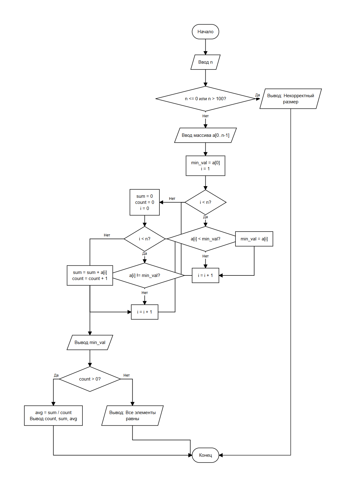

# Домашнее задание к работе 11

## Условие задачи

С одномерным массивом, состоящим из n вводимых с клавиатуры положительных и отрицательных целых чисел, выполнить следующие вычисления:
Вычислить среднее арифметическое всех значений элементов массива, кроме минимального значения (Вариант 1).

## 1. Алгоритм и блок-схема

### Алгоритм
1. Начало
2. Ввод количества элементов массива `n`
3. Проверка корректности размера: если `n <= 0` или `n > 100`, вывод сообщения об ошибке и завершение программы
4. Ввод элементов массива `a[0..n-1]` с клавиатуры
5. Поиск минимального значения:
   - Инициализация: `min_val = a[0]`, `i = 1`
   - Цикл пока `i < n`:
     - Если `a[i] < min_val`, то `min_val = a[i]`
     - `i = i + 1`
6. Подсчёт суммы и количества элементов, не равных минимальному:
   - Инициализация: `sum = 0`, `count = 0`, `i = 0`
   - Цикл пока `i < n`:
     - Если `a[i] != min_val`:
       - `sum = sum + a[i]`
       - `count = count + 1`
     - `i = i + 1`
7. Вывод минимального значения `min_val`
8. Проверка:
   - Если `count > 0`:
     - Вычисление среднего: `avg = sum / count`
     - Вывод количества элементов `count`, их суммы `sum` и среднего значения `avg`
   - Иначе:
     - Вывод сообщения о том, что все элементы массива равны минимальному
9. Конец

### Блок-схема


## 3. Результаты работы программы

```
Введите количество элементов массива: 5
Введите 5 элементов массива:
10 -3 5 -3 8
Минимальный элемент: -3
Количество элементов кроме минимального: 3
Сумма элементов: 23
Среднее арифметическое (кроме минимального): 7.67
```

```
Введите количество элементов массива: 4
Введите 4 элементов массива:
7 12 3 9
Минимальный элемент: 3
Количество элементов кроме минимального: 3
Сумма элементов: 28
Среднее арифметическое (кроме минимального): 9.33
```

```
Введите количество элементов массива: 3
Введите 3 элементов массива:
4 4 4
Минимальный элемент: 4
Все элементы массива равны минимальному значению
```

## 4. Информация о разработчике

Азиханов Дамир, бТИИ-262
